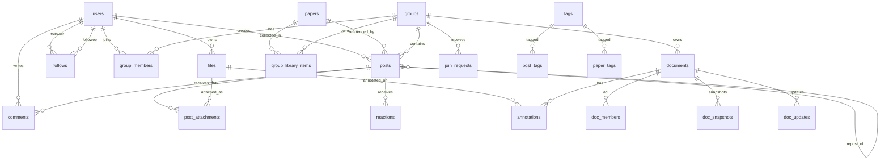

# 数据模型设计：学术论文社区与协作平台

- 文档版本：v0.1（评审稿）
- 数据库：PostgreSQL 16
- 关联文档：`product-requirements.md`、`technical-architecture.md`

---

## 1. 设计原则

1. **Paper 与 Post 分离**：论文是全局唯一实体，帖子引用它；同一论文可被无限次转发讨论。
2. **软删除优先**：内容类表使用 `deleted_at`，保证审计与恢复；用户注销走匿名化而非物理删除。
3. **时间统一 UTC**：所有 `timestamptz`，展示层按用户时区转换。
4. **主键策略**：对外暴露使用 UUIDv7（有序、不可枚举），避免自增 ID 泄露业务量。
5. **计数冗余**：`like_count` / `comment_count` 等冗余在主体表，异步更新，避免详情页聚合查询。
6. **权限外置**：文件与文档的可见性由 `visibility` + 关联实体（post/group）共同决定，不在文件表重复存 ACL。

---

## 2. ER 概览



---

## 3. 枚举类型

```sql
CREATE TYPE user_role        AS ENUM ('user', 'admin');
CREATE TYPE verify_type      AS ENUM ('none', 'scholar', 'influencer');
CREATE TYPE post_type        AS ENUM ('original', 'repost');
CREATE TYPE post_visibility  AS ENUM ('public', 'followers', 'group', 'private');
CREATE TYPE file_status      AS ENUM ('pending', 'uploading', 'uploaded',
                                      'scanning', 'transcoding', 'ready',
                                      'rejected', 'failed');
CREATE TYPE file_kind        AS ENUM ('pdf', 'office_doc', 'office_slide',
                                      'office_sheet', 'image', 'markdown',
                                      'code', 'latex', 'video', 'archive', 'other');
CREATE TYPE group_join_policy AS ENUM ('public', 'request', 'invite');
CREATE TYPE group_role       AS ENUM ('owner', 'admin', 'member');
CREATE TYPE doc_role         AS ENUM ('owner', 'editor', 'viewer');
CREATE TYPE doc_status       AS ENUM ('draft', 'active', 'archived');
CREATE TYPE notify_type      AS ENUM ('comment', 'reply', 'mention', 'repost',
                                      'like_agg', 'join_request', 'doc_edit',
                                      'system');
CREATE TYPE report_status    AS ENUM ('pending', 'reviewing', 'resolved', 'rejected');
```

---

## 4. 表结构

### 4.1 用户与关系

```sql
CREATE TABLE users (
    id                uuid PRIMARY KEY,
    email             citext UNIQUE,
    email_verified_at timestamptz,
    password_hash     text,
    name              varchar(64)  NOT NULL,
    handle            varchar(32)  NOT NULL UNIQUE,
    avatar_key        text,
    bio               varchar(280),
    institution       varchar(128),
    research_fields   text[]       NOT NULL DEFAULT '{}',
    verify_type       verify_type  NOT NULL DEFAULT 'none',
    verify_org        varchar(128),
    role              user_role    NOT NULL DEFAULT 'user',
    status            varchar(16)  NOT NULL DEFAULT 'active',
    last_active_at    timestamptz,
    created_at        timestamptz  NOT NULL DEFAULT now(),
    updated_at        timestamptz  NOT NULL DEFAULT now(),
    deleted_at        timestamptz
);

CREATE TABLE user_oauth_accounts (
    id            uuid PRIMARY KEY,
    user_id       uuid NOT NULL REFERENCES users(id) ON DELETE CASCADE,
    provider      varchar(32) NOT NULL,
    provider_uid  varchar(128) NOT NULL,
    created_at    timestamptz NOT NULL DEFAULT now(),
    UNIQUE (provider, provider_uid)
);

CREATE TABLE follows (
    follower_id  uuid NOT NULL REFERENCES users(id) ON DELETE CASCADE,
    followee_id  uuid NOT NULL REFERENCES users(id) ON DELETE CASCADE,
    created_at   timestamptz NOT NULL DEFAULT now(),
    PRIMARY KEY (follower_id, followee_id),
    CHECK (follower_id <> followee_id)
);
```

索引：

```sql
CREATE INDEX idx_users_handle ON users (handle);
CREATE INDEX idx_follows_followee ON follows (followee_id, created_at DESC);
```

### 4.2 论文实体

```sql
CREATE TABLE papers (
    id              uuid PRIMARY KEY,
    doi             varchar(128) UNIQUE,
    arxiv_id        varchar(32) UNIQUE,
    openreview_id   varchar(64),
    title           text NOT NULL,
    title_norm      varchar(512) NOT NULL,
    authors         jsonb NOT NULL DEFAULT '[]',   -- [{name, affiliation, orcid}]
    abstract        text,
    venue           varchar(256),
    published_at    date,
    citation_count  integer NOT NULL DEFAULT 0,
    pdf_file_id     uuid REFERENCES files(id),
    meta_source     varchar(32),
    meta_fetched_at timestamptz,
    dedupe_hash     char(64) UNIQUE,               -- title_norm+author+year 的 sha256
    created_by      uuid REFERENCES users(id),
    created_at      timestamptz NOT NULL DEFAULT now(),
    updated_at      timestamptz NOT NULL DEFAULT now()
);
```

要点：

- `doi` / `arxiv_id` / `dedupe_hash` 三个唯一索引承担去重；无 DOI 时靠 `dedupe_hash`；
- `authors` 用 JSONB，避免为低频查询建关联表；若后续需要「按作者检索」，再拆 `paper_authors`；
- `pdf_file_id` 允许多人对同一 Paper 上传不同版本，实际以「首个可用」展示，其余存附件。

### 4.3 帖子与互动

```sql
CREATE TABLE posts (
    id             uuid PRIMARY KEY,
    author_id      uuid NOT NULL REFERENCES users(id),
    type           post_type NOT NULL DEFAULT 'original',
    content_html   text,                  -- 已 sanitize
    content_text   text,                  -- 供检索
    paper_id       uuid REFERENCES papers(id),
    repost_of      uuid REFERENCES posts(id),
    group_id       uuid REFERENCES groups(id),
    visibility     post_visibility NOT NULL DEFAULT 'public',
    like_count     integer NOT NULL DEFAULT 0,
    comment_count  integer NOT NULL DEFAULT 0,
    repost_count   integer NOT NULL DEFAULT 0,
    hot_score      real NOT NULL DEFAULT 0,
    created_at     timestamptz NOT NULL DEFAULT now(),
    updated_at     timestamptz NOT NULL DEFAULT now(),
    deleted_at     timestamptz,
    CHECK (type <> 'repost' OR repost_of IS NOT NULL)
);

CREATE INDEX idx_posts_feed_all   ON posts (created_at DESC, id DESC)
    WHERE deleted_at IS NULL AND visibility = 'public' AND group_id IS NULL;
CREATE INDEX idx_posts_author     ON posts (author_id, created_at DESC)
    WHERE deleted_at IS NULL;
CREATE INDEX idx_posts_paper      ON posts (paper_id, created_at DESC)
    WHERE deleted_at IS NULL;
CREATE INDEX idx_posts_group      ON posts (group_id, created_at DESC)
    WHERE deleted_at IS NULL;
CREATE INDEX idx_posts_hot        ON posts (hot_score DESC, created_at DESC)
    WHERE deleted_at IS NULL AND visibility = 'public';
```

```sql
CREATE TABLE post_attachments (
    id           uuid PRIMARY KEY,
    post_id      uuid NOT NULL REFERENCES posts(id) ON DELETE CASCADE,
    file_id      uuid NOT NULL REFERENCES files(id),
    position     smallint NOT NULL DEFAULT 0,
    UNIQUE (post_id, file_id)
);

CREATE TABLE comments (
    id           uuid PRIMARY KEY,
    post_id      uuid NOT NULL REFERENCES posts(id) ON DELETE CASCADE,
    parent_id    uuid REFERENCES comments(id) ON DELETE CASCADE,
    author_id    uuid NOT NULL REFERENCES users(id),
    content_html text NOT NULL,
    content_text text NOT NULL,
    like_count   integer NOT NULL DEFAULT 0,
    created_at   timestamptz NOT NULL DEFAULT now(),
    deleted_at   timestamptz
);
CREATE INDEX idx_comments_post ON comments (post_id, created_at);

CREATE TABLE reactions (
    user_id     uuid NOT NULL REFERENCES users(id) ON DELETE CASCADE,
    target_type varchar(16) NOT NULL,        -- post | comment
    target_id   uuid NOT NULL,
    kind        varchar(16) NOT NULL,        -- like | bookmark
    created_at  timestamptz NOT NULL DEFAULT now(),
    PRIMARY KEY (user_id, target_type, target_id, kind)
);
CREATE INDEX idx_reactions_target ON reactions (target_type, target_id, kind);
```

> `reactions` 用多态外键换取扩展性；对 `post` 的高频计数查询由 `posts.*_count` 冗余承载，不在线聚合。

### 4.4 文件与预览

```sql
CREATE TABLE files (
    id             uuid PRIMARY KEY,
    owner_id       uuid NOT NULL REFERENCES users(id),
    storage_key    text NOT NULL,
    original_name  varchar(255) NOT NULL,
    mime           varchar(128) NOT NULL,
    kind           file_kind NOT NULL,
    size_bytes     bigint NOT NULL,
    sha256         char(64),
    status         file_status NOT NULL DEFAULT 'pending',
    scan_result    varchar(32),
    page_count     integer,
    cover_key      text,
    text_layer_key text,
    error_reason   text,
    retry_count    smallint NOT NULL DEFAULT 0,
    visibility     post_visibility NOT NULL DEFAULT 'public',
    created_at     timestamptz NOT NULL DEFAULT now(),
    ready_at       timestamptz
);

CREATE INDEX idx_files_owner  ON files (owner_id, created_at DESC);
CREATE INDEX idx_files_status ON files (status) WHERE status NOT IN ('ready', 'rejected');
CREATE UNIQUE INDEX uq_files_sha ON files (owner_id, sha256) WHERE sha256 IS NOT NULL;

CREATE TABLE file_pages (
    file_id     uuid NOT NULL REFERENCES files(id) ON DELETE CASCADE,
    page_no     integer NOT NULL,
    image_key   text NOT NULL,
    width       integer NOT NULL,
    height      integer NOT NULL,
    text_chars  integer NOT NULL DEFAULT 0,
    PRIMARY KEY (file_id, page_no)
);
```

### 4.5 群组

```sql
CREATE TABLE groups (
    id           uuid PRIMARY KEY,
    name         varchar(64) NOT NULL,
    slug         varchar(64) UNIQUE,
    description  varchar(500),
    cover_key    text,
    owner_id     uuid NOT NULL REFERENCES users(id),
    join_policy  group_join_policy NOT NULL DEFAULT 'invite',
    member_count integer NOT NULL DEFAULT 1,
    created_at   timestamptz NOT NULL DEFAULT now(),
    deleted_at   timestamptz
);

CREATE TABLE group_members (
    group_id   uuid NOT NULL REFERENCES groups(id) ON DELETE CASCADE,
    user_id    uuid NOT NULL REFERENCES users(id) ON DELETE CASCADE,
    role       group_role NOT NULL DEFAULT 'member',
    joined_at  timestamptz NOT NULL DEFAULT now(),
    PRIMARY KEY (group_id, user_id)
);
CREATE INDEX idx_group_members_user ON group_members (user_id);

CREATE TABLE group_invites (
    id          uuid PRIMARY KEY,
    group_id    uuid NOT NULL REFERENCES groups(id) ON DELETE CASCADE,
    code        varchar(32) NOT NULL UNIQUE,
    created_by  uuid NOT NULL REFERENCES users(id),
    expires_at  timestamptz,
    max_uses    integer,
    used_count  integer NOT NULL DEFAULT 0,
    created_at  timestamptz NOT NULL DEFAULT now()
);

CREATE TABLE join_requests (
    id          uuid PRIMARY KEY,
    group_id    uuid NOT NULL REFERENCES groups(id) ON DELETE CASCADE,
    user_id     uuid NOT NULL REFERENCES users(id) ON DELETE CASCADE,
    message     varchar(280),
    status      report_status NOT NULL DEFAULT 'pending',
    reviewed_by uuid REFERENCES users(id),
    created_at  timestamptz NOT NULL DEFAULT now(),
    UNIQUE (group_id, user_id)
);

CREATE TABLE group_library_items (
    id          uuid PRIMARY KEY,
    group_id    uuid NOT NULL REFERENCES groups(id) ON DELETE CASCADE,
    paper_id    uuid REFERENCES papers(id),
    file_id     uuid REFERENCES files(id),
    added_by    uuid NOT NULL REFERENCES users(id),
    note        varchar(500),
    created_at  timestamptz NOT NULL DEFAULT now(),
    CHECK (paper_id IS NOT NULL OR file_id IS NOT NULL)
);
CREATE INDEX idx_group_library ON group_library_items (group_id, created_at DESC);
```

### 4.6 论文文档与协同

```sql
CREATE TABLE documents (
    id               uuid PRIMARY KEY,
    group_id         uuid NOT NULL REFERENCES groups(id) ON DELETE CASCADE,
    title            varchar(256) NOT NULL,
    status           doc_status NOT NULL DEFAULT 'draft',
    default_role     doc_role NOT NULL DEFAULT 'editor',
    latest_snapshot  integer NOT NULL DEFAULT 0,
    latest_update_seq bigint NOT NULL DEFAULT 0,
    word_count       integer NOT NULL DEFAULT 0,
    created_by       uuid NOT NULL REFERENCES users(id),
    created_at       timestamptz NOT NULL DEFAULT now(),
    updated_at       timestamptz NOT NULL DEFAULT now(),
    deleted_at       timestamptz
);
CREATE INDEX idx_documents_group ON documents (group_id, updated_at DESC);

CREATE TABLE doc_members (
    doc_id     uuid NOT NULL REFERENCES documents(id) ON DELETE CASCADE,
    user_id    uuid NOT NULL REFERENCES users(id) ON DELETE CASCADE,
    role       doc_role NOT NULL,
    granted_by uuid REFERENCES users(id),
    created_at timestamptz NOT NULL DEFAULT now(),
    PRIMARY KEY (doc_id, user_id)
);

CREATE TABLE doc_snapshots (
    doc_id      uuid NOT NULL REFERENCES documents(id) ON DELETE CASCADE,
    version     integer NOT NULL,
    storage_key text NOT NULL,
    size_bytes  bigint NOT NULL,
    label       varchar(64),
    created_by  uuid REFERENCES users(id),
    created_at  timestamptz NOT NULL DEFAULT now(),
    PRIMARY KEY (doc_id, version)
);

CREATE TABLE doc_updates (
    doc_id      uuid NOT NULL REFERENCES documents(id) ON DELETE CASCADE,
    seq         bigint NOT NULL,
    storage_key text NOT NULL,
    size_bytes  integer NOT NULL,
    created_at  timestamptz NOT NULL DEFAULT now(),
    PRIMARY KEY (doc_id, seq)
);
```

并发控制：`documents.latest_update_seq` 由 WS 网关在写入对象存储后原子递增（`UPDATE ... SET latest_update_seq = latest_update_seq + 1 RETURNING`），保证客户端补拉顺序。

### 4.7 批注

```sql
CREATE TABLE annotations (
    id          uuid PRIMARY KEY,
    target_type varchar(16) NOT NULL,        -- doc | file
    target_id   uuid NOT NULL,
    author_id   uuid NOT NULL REFERENCES users(id),
    anchor      jsonb NOT NULL,              -- Yjs RelativePosition 或 {page, rects}
    quoted_text text,
    content     text NOT NULL,
    resolved_at timestamptz,
    resolved_by uuid REFERENCES users(id),
    created_at  timestamptz NOT NULL DEFAULT now(),
    deleted_at  timestamptz
);
CREATE INDEX idx_annotations_target ON annotations (target_type, target_id, created_at);
```

> `target_type = 'doc'` 时 `anchor` 存 `{relPos: "<base64>"}`，由服务端在导出/渲染时重算绝对位置；`target_type = 'file'` 时存 `{page, rects:[[x,y,w,h],...]}`（归一化 0–1 坐标）。

### 4.8 标签

```sql
CREATE TABLE tags (
    id         uuid PRIMARY KEY,
    name       varchar(64) NOT NULL,
    slug       varchar(64) NOT NULL UNIQUE,
    use_count  integer NOT NULL DEFAULT 0,
    created_at timestamptz NOT NULL DEFAULT now()
);

CREATE TABLE post_tags (
    post_id uuid NOT NULL REFERENCES posts(id) ON DELETE CASCADE,
    tag_id  uuid NOT NULL REFERENCES tags(id) ON DELETE CASCADE,
    PRIMARY KEY (post_id, tag_id)
);
CREATE INDEX idx_post_tags_tag ON post_tags (tag_id);

CREATE TABLE paper_tags (
    paper_id uuid NOT NULL REFERENCES papers(id) ON DELETE CASCADE,
    tag_id   uuid NOT NULL REFERENCES tags(id) ON DELETE CASCADE,
    PRIMARY KEY (paper_id, tag_id)
);
```

### 4.9 通知与审核

```sql
CREATE TABLE notifications (
    id           uuid PRIMARY KEY,
    user_id      uuid NOT NULL REFERENCES users(id) ON DELETE CASCADE,
    type         notify_type NOT NULL,
    actor_id     uuid REFERENCES users(id),
    target_type  varchar(16),
    target_id    uuid,
    payload      jsonb NOT NULL DEFAULT '{}',
    read_at      timestamptz,
    created_at   timestamptz NOT NULL DEFAULT now()
);
CREATE INDEX idx_notifications_unread ON notifications (user_id, created_at DESC)
    WHERE read_at IS NULL;

CREATE TABLE notification_prefs (
    user_id      uuid PRIMARY KEY REFERENCES users(id) ON DELETE CASCADE,
    muted_types  notify_type[] NOT NULL DEFAULT '{}',
    email_digest varchar(16) NOT NULL DEFAULT 'daily'
);

CREATE TABLE reports (
    id           uuid PRIMARY KEY,
    reporter_id  uuid NOT NULL REFERENCES users(id),
    target_type  varchar(16) NOT NULL,
    target_id    uuid NOT NULL,
    reason       varchar(64) NOT NULL,
    detail       varchar(500),
    status       report_status NOT NULL DEFAULT 'pending',
    handled_by   uuid REFERENCES users(id),
    handled_at   timestamptz,
    created_at   timestamptz NOT NULL DEFAULT now()
);
CREATE INDEX idx_reports_pending ON reports (created_at) WHERE status = 'pending';

CREATE TABLE blocks (
    blocker_id uuid NOT NULL REFERENCES users(id) ON DELETE CASCADE,
    blocked_id uuid NOT NULL REFERENCES users(id) ON DELETE CASCADE,
    created_at timestamptz NOT NULL DEFAULT now(),
    PRIMARY KEY (blocker_id, blocked_id)
);
```

### 4.10 检索（MVP 方案）

```sql
CREATE TABLE search_documents (
    id          uuid PRIMARY KEY,
    entity_type varchar(16) NOT NULL,        -- paper | post | user | group
    entity_id   uuid NOT NULL,
    title       text,
    body        text,
    lang        varchar(8) NOT NULL DEFAULT 'zh',
    tsv         tsvector NOT NULL,
    updated_at  timestamptz NOT NULL DEFAULT now(),
    UNIQUE (entity_type, entity_id)
);
CREATE INDEX idx_search_tsv ON search_documents USING gin (tsv);
CREATE INDEX idx_search_title_trgm ON search_documents USING gin (title gin_trgm_ops);
```

写入侧由队列事件维护，`tsv` 构造示例：

```sql
UPDATE search_documents SET tsv =
    setweight(to_tsvector('simple', coalesce(title,'')), 'A') ||
    setweight(to_tsvector('simple', coalesce(body,'')),  'B');
```

> 中文分词需安装 `pg_jieba`/`zhparser`，配置自定义 text search configuration；未安装时以 `simple` 分词 + `pg_trgm` 兜底。

### 4.11 计数与热度维护

- 互动写入后发 `counter.delta` 队列，Worker 执行 `UPDATE ... SET like_count = like_count + $1`，避免高频行锁；
- `hot_score` 由定时任务（5min）批量重算窗口内帖子：

```sql
UPDATE posts p SET hot_score =
    (p.like_count + 2.0 * p.comment_count + 3.0 * p.repost_count)
    / power(extract(epoch FROM (now() - p.created_at)) / 3600.0 + 2, 1.5)
WHERE p.created_at > now() - interval '72 hours'
  AND p.deleted_at IS NULL AND p.visibility = 'public';
```

---

## 5. 关键查询模式

### 5.1 关注流（游标分页）

```sql
SELECT p.*
FROM posts p
JOIN follows f ON f.followee_id = p.author_id AND f.follower_id = $1
WHERE p.deleted_at IS NULL
  AND p.group_id IS NULL
  AND p.visibility IN ('public','followers')
  AND (p.created_at, p.id) < ($cursor_ts, $cursor_id)
ORDER BY p.created_at DESC, p.id DESC
LIMIT 20;
```

索引：`follows (follower_id, followee_id)` + `posts (author_id, created_at DESC)`；数据量大后改为「写扩散」收件箱表（P2）。

### 5.2 热门流

```sql
SELECT id FROM posts
WHERE deleted_at IS NULL AND visibility = 'public' AND group_id IS NULL
  AND created_at > now() - interval '72 hours'
ORDER BY hot_score DESC, created_at DESC
LIMIT 20 OFFSET $offset;
```

短期可用 offset 分页；超过 500 条后改用 `hot_score` 游标。

### 5.3 群内动态

```sql
SELECT * FROM posts
WHERE group_id = $1 AND deleted_at IS NULL
  AND (created_at, id) < ($cursor_ts, $cursor_id)
ORDER BY created_at DESC, id DESC
LIMIT 30;
```

### 5.4 权限判定（预览）

```sql
SELECT f.id
FROM files f
LEFT JOIN post_attachments pa ON pa.file_id = f.id
LEFT JOIN posts p ON p.id = pa.post_id
LEFT JOIN group_members gm ON gm.group_id = p.group_id AND gm.user_id = $user
WHERE f.id = $file
  AND f.status = 'ready'
  AND (
      p.visibility = 'public'
      OR p.author_id = $user
      OR (p.visibility = 'group' AND gm.user_id IS NOT NULL)
  );
```

---

## 6. 权限矩阵（数据层映射）

| 资源 | 读 | 写 |
|---|---|---|
| `posts` | `visibility` + 关注关系 + 群成员 | `author_id` |
| `files` | 关联 Post 可见性或上传者 | `owner_id` |
| `groups` | `join_policy` 与成员身份 | `group_members.role` |
| `documents` | `doc_members` 或群成员（`default_role`） | `doc_role IN ('owner','editor')` |
| `annotations` | 随目标可读 | 作者本人 + 文档 owner |

实现位置：Go 侧的 `internal/policy` 包统一计算，禁止在 Handler 内散落判断。

---

## 7. 数据生命周期

| 数据 | 保留策略 |
|---|---|
| 软删除内容 | 30 天后物理删除（保留审计摘要） |
| `doc_updates` | 90 天后合并入快照并删除 |
| `export` 产物 | 7 天 |
| 孤立文件 | 无引用 30 天清理（转码产物先删） |
| 通知 | 180 天归档 |
| 审计日志 | ≥ 180 天 |
| 用户注销 | 匿名化：`email` 置空、`name` 改为「已注销用户」，内容保留但解除关联 |

---

## 8. 迁移与演进

1. 迁移工具：goose（纯 SQL 迁移，见 `apps/api/db/migrations`）；
2. 兼容策略：只做加法（新增列可空、新增表），破坏性变更走「双写 → 回填 → 切换 → 清理」；
3. 未来拆分点：
   - `paper_authors` 独立表（按作者检索需求出现时）；
   - 关注流改「收件箱」写扩散（关注关系 > 500 或 P95 > 300ms 时）；
   - `posts` 按 `created_at` 月分区（单表 > 5000 万行时）；
   - 检索迁 Meilisearch（见技术架构文档触发条件）。

---

## 9. 待确认项

1. 是否允许「公开群」，影响 `groups.slug` 与发现页索引；
2. 文件配额是否按用户/群计费，需新增 `storage_quotas` 表；
3. 论文作者是否需要结构化存储（ORCID 检索）；
4. 文档是否需要「模板」实体（`doc_templates`），以及模板的共享范围；
5. 是否需要多语言内容字段（当前以中文为主，检索配置需相应扩展）。