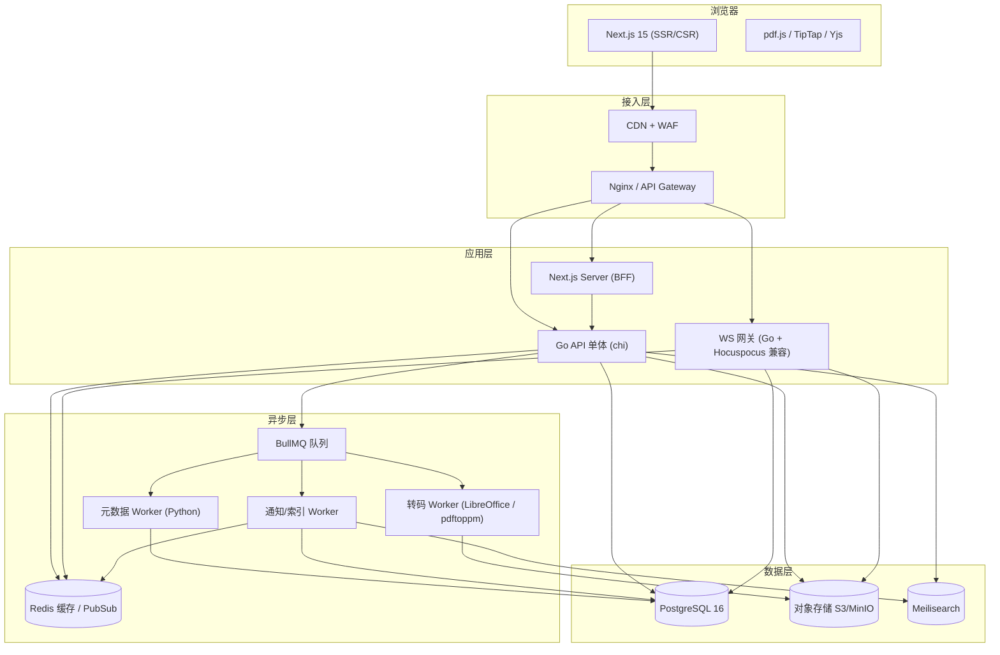
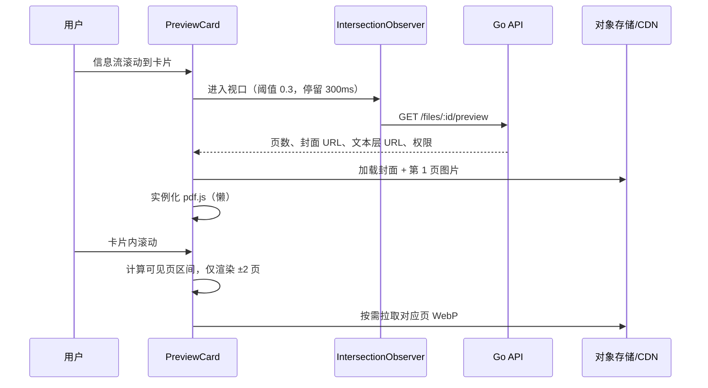

# 技术架构设计：学术论文社区与协作平台

- 文档版本：v0.2（后端改为 Go）
- 关联文档：`product-requirements.md`、`data-model.md`
- 变更记录：
  - v0.2：主后端由 NestJS 改为 **Go**（chi + pgx + sqlc + goose）；WS 网关与前端选型不变。

---

## 1. 架构总览

### 1.1 设计原则

1. **单体优先**：首年 DAU 1 万量级，模块化单体 + 独立转码 Worker 足够，避免过早微服务化；
2. **重活异步**：文件转码、元数据抓取、通知扇出、检索索引全部走队列；
3. **按域分模块**：`identity / content / paper / group / doc / search / notify`，模块间只经接口调用，为未来拆分预留边界；
4. **实时链路独立**：WebSocket 网关与 HTTP 服务分离部署，避免长连接挤占请求线程；
5. **前端类型共享**：API 契约用 OpenAPI 生成客户端类型，减少前后端漂移。

### 1.2 逻辑架构



### 1.3 请求链路

- **读**：浏览器 → CDN（静态资源）→ Next.js SSR/ISR（页面）→ Go API（数据）→ PG/Redis；
- **写**：浏览器 → Go API → PG（事务）→ 发队列 → 202/200 返回；
- **实时**：浏览器 → WS 网关 → Redis Pub/Sub 广播；
- **文件**：浏览器 → 预签名 URL 直传对象存储 → 回调 Go API → 入转码队列。

---

## 2. 技术栈决策

### 2.1 选型表

| 层 | 选型 | 理由 | 备选（否决原因） |
|---|---|---|---|
| Web 框架 | Next.js 15 App Router + TS | 论文页/作者页需 SSR 做 SEO；RSC 降低首屏 JS | Vite SPA（SEO 差）；Remix（生态较小） |
| UI | Tailwind + shadcn/ui | 高密度信息流需要精细控制；可访问性基础好 | Ant Design（视觉偏后台） |
| 服务端状态 | TanStack Query | 无限滚动、乐观更新、游标分页成熟 | Redux（样板过多） |
| 富文本编辑器 | TipTap (ProseMirror) | 协同插件、公式、表格、批注锚点生态最全 | Lexical（协同生态较弱）；Slate（维护成本高） |
| PDF 渲染 | pdf.js | 可控虚拟滚动与按需渲染；文本层完善 | 浏览器内置 viewer（无法定制） |
| 公式 | KaTeX | 服务端可预渲染，速度快 | MathJax（体积大） |
| 协同 | Yjs + Hocuspocus | CRDT 天然支持离线合并；可自托管 | OT 自研（复杂）；Liveblocks（数据出境/成本） |
| 主后端 | **Go 1.25 + chi** | 低内存、高并发、部署为单二进制；模块化单体易维护 | NestJS（运行时开销大）；Spring Boot（人力成本） |
| 数据访问 | **pgx + sqlc** | SQL 直写、编译期类型安全，天然复用 `data-model.md` 的 DDL | GORM（隐式查询、性能不可控） |
| 迁移 | **goose** | 纯 SQL 迁移，可审阅、可回滚 | Prisma Migrate（绑定 Node 生态） |
| 元数据/转码服务 | Python FastAPI + Celery 旁路 | Crossref/arXiv/S2 客户端与 PDF 解析生态好 | 全 Go（PDF 工具链弱） |
| 主库 | PostgreSQL 16+ | JSONB 存元数据、tsvector 检索、pgvector 预留 | MySQL（JSON/检索较弱） |
| 中文检索 | PG + pg_jieba → Meilisearch | MVP 零额外组件；量级上来平滑迁移 | 直接 ES（运维重） |
| 缓存/队列 | Redis 7 + BullMQ | 复用同一实例做缓存、Pub/Sub、队列 | RabbitMQ（多一套运维） |
| 对象存储 | S3 兼容（MinIO / OSS） | 预签名直传、生命周期策略 | 本地磁盘（不可水平扩展） |
| 转码 | LibreOffice headless + pdftoppm + sharp | 覆盖 Office/PDF/图片，无商业授权 | OnlyOffice DS（重、协同与 Yjs 冲突） |
| 部署 | Docker Compose → K8s | 单机可跑通，后续平滑上云 | Serverless（长连接与转码不友好） |
| 可观测 | Sentry + OpenTelemetry + Prometheus | 错误、链路、指标三层覆盖 | 仅日志（定位慢） |

### 2.2 版本与运行时

- **Go 1.25**（后端主服务）；Node.js 22 LTS + pnpm workspace（前端 monorepo）；
- Python 3.11（转码 Worker）；
- PostgreSQL 16+（需 `pg_trgm`、`pg_jieba` 或 `zhparser` 扩展）；
- Redis 7；
- 浏览器基线：Chrome/Edge 110+、Safari 16+。

---

## 3. 仓库与模块划分

```
thesis-shared/
├─ apps/
│  ├─ web/                 # Next.js 前端 + BFF
│  ├─ api/                 # Go 主服务（chi + pgx + sqlc）
│  │  ├─ cmd/server/       # 入口
│  │  ├─ internal/         # config / db / handler / server / 各业务模块
│  │  └─ db/               # goose 迁移 + sqlc 查询
│  ├─ ws/                  # WS 网关（Go）
│  └─ worker/              # asynq Worker（Go：通知/索引）
├─ services/
│  └─ paper-worker/         # Python FastAPI + Celery（元数据/PDF 解析）
├─ packages/
│  ├─ contracts/            # OpenAPI 契约 / 生成前端类型
│  └─ ui/                   # 共享前端组件（预览卡、编辑器壳）
├─ infra/
│  ├─ docker/               # Dockerfile、compose
│  └─ k8s/                  # 部署清单（P2）
└─ docs/
```

### 3.1 Go 服务模块边界

| 模块 | 职责 | 对外接口 |
|---|---|---|
| `identity` | 账号、OAuth、会话、认证标识 | `/auth/*`、`/users/*` |
| `content` | Post、评论、互动、信息流查询 | `/posts/*`、`/feed/*` |
| `paper` | 论文元数据、去重、文件关联 | `/papers/*` |
| `file` | 上传凭证、转码任务、预览元数据 | `/files/*` |
| `group` | 群组、成员、群内动态 | `/groups/*` |
| `doc` | 文档 CRUD、权限、快照、导出 | `/docs/*` |
| `search` | 统一检索与索引同步 | `/search/*` |
| `notify` | 通知生成、偏好、已读 | `/notifications/*` |
| `moderation` | 举报、审核队列、下架 | `/admin/*` |

模块间仅通过注入的 Service 接口调用，禁止跨模块直接读表。Go 侧对应 `internal/{identity,content,paper,file,group,doc,search,notify,moderation}` 包，每个包暴露一个 `Service` 结构体。

---

## 4. 关键链路设计

### 4.1 文件上传与转码流水线

状态机：

```
pending → uploading → uploaded → scanning → transcoding → ready
                                   ↘ rejected（病毒/类型不符）
                                            ↘ failed（可重试 3 次）
```

流程：

1. 客户端调 `POST /files/presign`，服务端校验配额与 MIME 白名单，返回 S3 预签名 PUT URL 与 `file_id`；
2. 客户端直传对象存储（分片上传，≤ 100MB）；
3. 客户端调 `POST /files/:id/complete`，服务端校验对象大小与 ETag，写入 `files` 记录并入队；
4. Worker 依次执行：ClamAV 扫描 → 按类型分派转码 → 写回产物 key 与页数；
5. 转码产物：
   - PDF：原文件、每页 WebP（宽 1200，质量 80）、文本层 JSON（按页的文本块与坐标）；
   - Office：LibreOffice 转 PDF 后复用上述流程；
   - 图片：多尺寸 WebP；
   - 视频（P2）：HLS 切片。
6. 前端轮询或订阅 `file.status`（SSE），`ready` 后才渲染预览。

幂等与重试：任务以 `file_id + pipeline_version` 为幂等键；转码失败保留原文件，前端降级为「下载查看」。

### 4.2 信息流卡片内联预览

这是体验核心，采用**双层渲染 + 视口裁剪**：



实现要点：

- **滚动隔离**：预览容器 `overflow-y: auto; overscroll-behavior: contain;`，并监听 `wheel` 边界做外层滚动接管（到达首/末页时允许外层继续滚动）；
- **渲染对象池**：最多保留 5 个 canvas，超出按 LRU 释放；离开视口 10s 后销毁实例；
- **图片优先策略**：默认渲染服务端生成的 WebP 页图，文本层按需叠加用于选中/搜索，避免移动端 pdf.js 性能问题；
- **降级链**：WebP 页图 → pdf.js 渲染 → 封面 + 下载按钮；
- **内存预算**：单卡 ≤ 80MB，全页同时可见卡片数 ≤ 3（虚拟列表）。

### 4.3 群组消息与实时推送

- 群内消息写 PG 后，向 Redis channel `group:{id}` 发布；
- WS 网关订阅并按房间广播；离线用户由 `notify` 模块落库，上线后拉取；
- 消息序号：每个群维护单调递增 `seq`（PG 序列或 Redis INCR 后落库），客户端按 `seq` 去重与补拉；
- 在线状态与「正在输入」走 Redis TTL key，不落库。

### 4.4 协同编辑

```mermaid
graph LR
    C1[客户端 A] -- Yjs update --> HP[Hocuspocus]
    C2[客户端 B] -- Yjs update --> HP
    HP -- 广播 --> C1
    HP -- 广播 --> C2
    HP -- 增量追加 --> S3[(updates/{doc_id}/{seq}.bin)]
    HP -- 每 5min / 断开 --> Snap[快照 → S3 + PG 元信息]
```

- **鉴权**：WS 握手携带 JWT，网关校验 `doc_permission`（群成员 + 文档级 ACL），失败返回 4403；
- **持久化**：增量 update 按 `seq` 追加至对象存储；快照用 `Y.encodeStateAsUpdate` 全量落盘，PG 只存指针与版本号；
- **恢复**：最新快照 + 后续增量回放；
- **批注锚点**：使用 Yjs `RelativePosition` 序列化为 JSON 存 `annotations.anchor`，正文编辑后自动重定位；
- **离线**：客户端 IndexedDB 缓存 Y.Doc，重连后交换 state vector 差量合并；
- **导出**：服务端加载 Y.Doc → 转 ProseMirror JSON → 生成 DOCX（docx 库）/ PDF（Playwright 打印）/ LaTeX（模板）。

冲突边界：同一段落的并发编辑由 CRDT 解决；结构性操作（如整章删除）需二次确认，避免误删合并困难。

### 4.5 论文元数据抓取

- 识别器：正则匹配 DOI（`10.\d{4,9}/...`）、arXiv（`\d{4}\.\d{4,5}`）、OpenReview/ACL URL；
- 抓取源优先级：Crossref → arXiv API → Semantic Scholar → OpenReview；
- 统一映射到内部 schema，字段缺失不阻塞发布；
- 去重键：`doi` 唯一索引；无 DOI 时用 `normalized_title + first_author + year` 的哈希做软去重；
- 抓取失败进入「待补全」队列，用户可手动填写；
- 引用数等易变字段按 7 天 TTL 异步刷新，不做实时请求。

### 4.6 检索

- MVP：PG `tsvector`（标题 A、摘要 B、正文 C，权重递减）+ `pg_trgm` 模糊匹配；中文用 `pg_jieba`；
- 索引同步：`content`/`paper` 写入后发 `index.upsert` 队列事件，Worker 更新 `search_document` 表；
- 迁移到 Meilisearch 的触发条件：单表 > 500 万行或 P95 查询 > 300ms；
- 结果排序：字段权重 + 时间衰减，不做个性化。

---

## 5. 存储规划

### 5.1 对象存储 Key 规范

```
original/{yyyy}/{mm}/{file_id}.{ext}
preview/{file_id}/page-{n}.webp
preview/{file_id}/text.json
cover/{file_id}.webp
avatar/{user_id}/{hash}.webp
doc-updates/{doc_id}/{seq}.bin
doc-snapshot/{doc_id}/{version}.bin
export/{doc_id}/{job_id}.docx
```

生命周期：

- `doc-updates` 保留 90 天后合并进快照并删除；
- `export` 7 天自动清理；
- 孤立文件（无引用 30 天）进入清理任务。

### 5.2 缓存策略

| Key | TTL | 内容 |
|---|---|---|
| `feed:following:{user_id}:{cursor}` | 60s | 关注流首页 |
| `feed:hot:{window}` | 30s | 热门榜 |
| `paper:meta:{id}` | 10min | 论文元数据 |
| `file:preview:{id}` | 1h | 预览元信息 |
| `user:session:{sid}` | 7d | 会话 |
| `rate:{scope}:{key}` | 动态 | 限流计数 |

---

## 6. 安全设计

| 风险 | 措施 |
|---|---|
| 恶意文件 | MIME 嗅探 + 扩展名/魔数双重校验 + ClamAV；转码在无网容器内执行 |
| 越权访问文件 | 私有桶 + 短时预签名；预览接口校验 Post/群可见性 |
| XSS | 服务端 sanitize（bluemonday 白名单），Markdown 渲染禁用原始 HTML |
| CSRF | SameSite=Lax + 双提交 Token（写接口） |
| 限流 | Redis 滑动窗口：登录 5/min/IP，发帖 10/h/用户，上传 30/h/用户 |
| 账号安全 | 密码 Argon2id；登录异常设备提醒；OAuth state 校验 |
| 数据泄露 | 日志脱敏（邮箱、IP 哈希）；导出接口审计 |
| 协同越权 | WS 握手鉴权 + 每条 update 会话级权限快照 |

---

## 7. 可观测性

- **日志**：Go 标准库 `log/slog` 结构化日志，`request_id` 贯穿 HTTP → 队列 → Worker；
- **指标**：QPS、P95 延迟、队列积压、转码失败率、WS 连接数、预览加载耗时；
- **追踪**：OpenTelemetry，重点埋点「信息流 → 预览 → 转码」链路；
- **告警**：转码失败率 > 5%、队列积压 > 1000、预览 P95 > 3s、错误率 > 1%。

---

## 8. 部署与环境

### 8.1 环境

| 环境 | 用途 | 数据 |
|---|---|---|
| local | Docker Compose 全栈 | 种子数据 |
| staging | 预发，与生产同构 | 脱敏副本 |
| prod | 生产 | — |

### 8.2 起步拓扑（Compose）

```yaml
services:
  web:        # Next.js
  api:        # Go (chi)
  ws:         # Go WS 网关
  worker:     # asynq Go worker
  paper:      # Python FastAPI + Celery
  postgres:
  redis:
  minio:
  meilisearch: # 可选，MVP 可关闭
  nginx:
```

### 8.3 扩容路径

1. 无状态服务（web/api/ws）水平扩副本，WS 用 Redis adapter；
2. 转码 Worker 按队列深度独立扩容（CPU 密集，限制并发 = 核数）；
3. PG 读写分离 → 分区（`posts` 按时间）→ 冷数据归档；
4. 对象存储接 CDN，预览图走长缓存（`Cache-Control: max-age=31536000, immutable`）。

---

## 9. 性能预算

| 场景 | 预算 |
|---|---|
| 信息流首屏 JS | < 200KB gzip（预览组件动态 import） |
| 单页 WebP | < 120KB |
| 预览首屏请求数 | ≤ 3（封面、首页图、预览元信息） |
| API P95 | 读 150ms，写 300ms |
| 转码并发 | 每 Worker 2 个 LibreOffice 进程（内存隔离） |

---

## 10. 风险与应对

| 风险 | 影响 | 应对 |
|---|---|---|
| 内联预览在低端设备卡顿 | 核心体验受损 | 默认页图方案；低端设备仅显示封面 + 前 3 页 |
| LibreOffice 版式失真 | Office 预览不可用 | 明确降级提示；复杂公式场景引导下载 |
| CRDT 文档体积膨胀 | 加载慢、存储涨 | 定期快照 + 增量合并；限制单文档历史长度 |
| 元数据源限流/变更 | 解析失败 | 多源降级 + 本地缓存 + 手动补录 |
| 冷启动内容不足 | 留存差 | 运营策展 + 大V 邀请，不靠算法 |
| 文件成本失控 | 存储费用 | 配额、生命周期、转码产物按需生成 |

---

## 11. 待确认项

1. 部署区域与合规要求（是否允许数据出境，决定 OAuth 与 AI 服务选型）；
2. 是否首期就引入 Meilisearch（若中文检索质量不达标则必须）；
3. Python 旁路服务的运维归属（是否需要独立 CI/CD）；
4. 文档导出是否需要与 Overleaf/LaTeX 工程互操作；
5. 预算约束下的对象存储选型（自建 MinIO vs 云 OSS）。